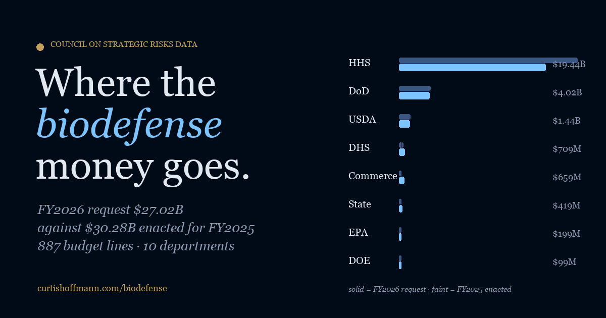

# US Biodefense Budget

Where the federal biodefense money goes, line by line: every budget line the Council on Strategic Risks counts as biodefense, from FY2019 actual spending to the FY2026 request, by department, office and spending category.

Live at **https://curtishoffmann.com/biodefense/**



## What it does

- **Overview.** Department and category breakdowns for the FY2026 request with FY2024 actual and FY2025 enacted behind them, and totals by year back to FY2019. Selecting a bar filters the whole page.
- **Programs.** A searchable, sortable table of every line (cards on a phone), with change from FY2025 enacted to the FY2026 request on each row, expandable descriptions from the budget justifications, and a "moved" marker for lines that changed office in the request instead of being cut. The filter state lives in the URL, so a view can be linked.
- **Index.** All 887 lines by department, crawlable without JavaScript.
- **Sources.** What actual, enacted and request mean, the caveats CSR attaches, and how the file was built.

Plain HTML, CSS and JavaScript. No framework, no chart library, no tracking.

## Data

Everything comes from the [Biodefense Budget Breakdown](https://councilonstrategicrisks.org/nolan/biodefense-budget-breakdown/) maintained by the Janne E. Nolan Center at the Council on Strategic Risks, which compiles program-level figures from congressional budget justifications. CSR publishes the workbook behind its dashboards as an Excel file ("Access the dataset (.xlsx)" on that page). Please cite them when reusing these numbers:

> Chwalek, Sabrina. "US Biodefense Budget Breakdown: Fiscal Year 2026 Update." Council on Strategic Risks, 9 December 2025.

`fetch_data.py` reads that workbook (one sheet per department, read by header name, standard library only) and writes [`data/programs.json`](data/programs.json) and [`data/meta.json`](data/meta.json). Two things it does on the way:

1. **Merges reorganizations.** A line that appears under one office through FY2025 and under another in the FY2026 request shows up in the workbook as two rows, one ending in zeros and one starting from zero. Shown that way, Project BioShield looked like it had been cut to $0 when it had moved to a proposed new office with $725 million. Rows that share a name and never overlap in time are merged into one line with a "moved" note; twelve lines were merged this way.
2. **Labels genuine duplicates.** Rows that share a name but do overlap in time (the same project split across sub-lines, or an EPA activity funded from two accounts) are kept apart and tagged with their program element number or office.

Totals reconcile with CSR's published figures: $30.40 billion FY2024 actual, $30.28 billion FY2025 enacted, $27.02 billion FY2026 request.

## Refreshing and building

```bash
python3 fetch_data.py path/to/csr_biodefense.xlsx   # convert CSR's workbook
python3 build.py                                     # regenerate index.html
```

Both need only Python 3. Serve the folder to view it (`python3 -m http.server`); the page fetches `data/programs.json`, which browsers block from a bare `file://` URL. Edit `src/template.html` for copy; `index.html` is generated and will be overwritten.

## Repository layout

```
index.html         built page
src/template.html  page template
build.py           fills the template from the data
fetch_data.py      converts CSR's workbook into data/programs.json
data/              programs.json, meta.json
assets/            stylesheet, script, social image, icons
robots.txt, sitemap.xml, LICENSE
```

## Earlier version

The first release (April 2026) carried 414 records inside `index.html`, covered only FY2024–FY2026, was about $90 million short on Defense each year, and listed reorganized programs twice so that several looked eliminated. This version rebuilds from CSR's full workbook, closes the gap, merges the moves, and adds the 2019–2023 history.

## License

Code is MIT-licensed. The budget data is the Council on Strategic Risks' work and is redistributed here reshaped but unchanged in substance; see their site for terms.

Made by [Curtis Hoffmann](https://curtishoffmann.com/).
